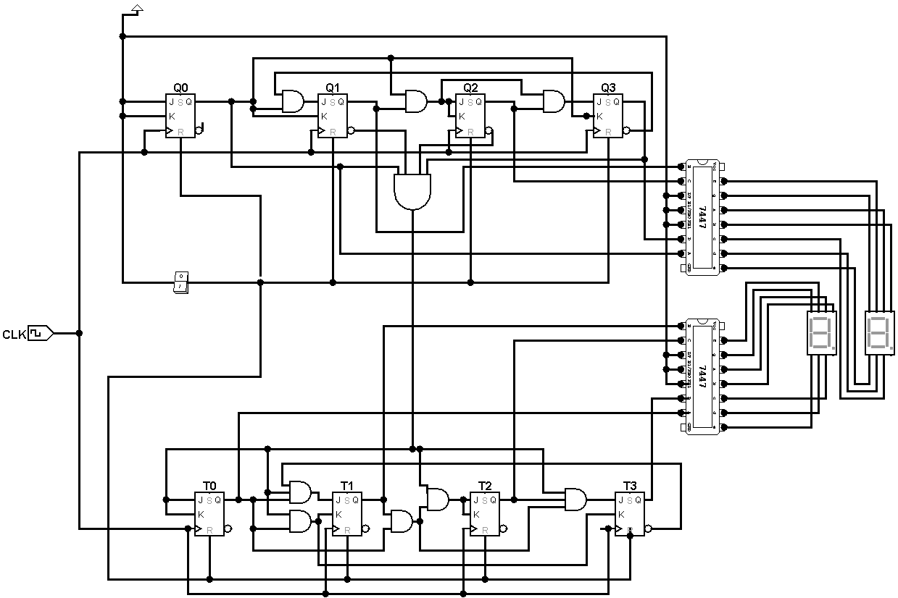

# 00–99 Synchronous Up Counter Using JK Flip-Flops

## Overview

This project is a two-digit synchronous up counter designed and simulated in Logisim Evolution. It uses JK flip-flops and displays the count on seven-segment displays.

## How to run the simulation

1. Open Logisim Evolution.
2. Select **File → Open** and choose the `.lsebdl` project file.
3. Turn on the reset switch. The display should show `00`.
4. Turn off the reset switch and enable the clock pulse to start counting.

## Circuit diagram

